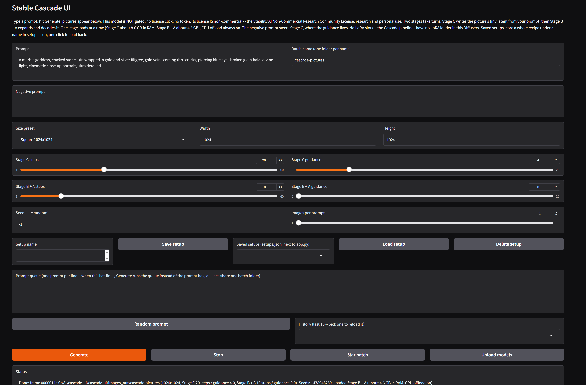

# Stable Cascade UI

## Example output

*Marble goddess, frame 000001 — the first picture this app ever rendered. Seed 1478948269.*

*Marble goddess, frame 000010. Seed 1262267330.*

*Neon double exposure, frame 000003. Seed 1828005206.*

*Neon double exposure, frame 000005. Seed 1182699632.*

*Porcelain cyborg, frame 000013. Seed 1841842714.*

All five generated with this app on an RTX 4070 12 GB, 1024x1024, at the stock settings: Stage C 20 steps / guidance 4.0, Stage B + A 10 steps / guidance 0.0.

## Before you start

- **Python: nothing to install.** Python 3.12 is included in this package, in the `python_embeded` folder, ComfyUI portable style. If you have **Python 3.10** (or any other Python) for other apps, it is left completely alone and is not needed here — Diffusers 0.42 dropped Python 3.10, which is why this app carries its own 3.12.
- **This model is NOT gated — no license click, no token.** Both Hugging Face repos download anonymously. There is no token box in this app because there is nothing to paste.
- **The model license IS non-commercial.** Stable Cascade is released under the **Stability AI Non-Commercial Research Community License**: research and non-commercial use only — no production use, no offering it as a hosted service to others. That is Stability's license for the model weights; the app code in this package is MIT (see License). The model card's own words: "The model is intended for research purposes only."
- A Windows PC with an NVIDIA graphics card (12 GB VRAM is the design target), about **20 GB free disk space**, and an internet connection.
- The first Generate downloads the model weights: **about 13.1 GB in total** across the two repos (the BF16 files only — the repos also carry much larger full-precision and variant files this app never fetches).
- **Status: PC-proven.** All three proofs passed on the target PC (RTX 4070 12 GB, 16 GB RAM) on Nov 1, 2026 — a first single image, a three-line queue, and batches of five at 1024x1024, all in one session, 16 frames. First frame: the marble goddess at the top of this page. A queue line of five frames takes about 17 seconds end to end: the app runs Stage C for every image of a click first, then loads the decoder once and renders them all.

**Stable Cascade, without Jupyter and without Colab.**

Stable Cascade is Stability AI's Würstchen-architecture cascade: instead of one big latent diffusion it runs three stages — **Stage C** writes a tiny 24x24 latent from the text, **Stage B** expands it, and the **Stage A** VQGAN decodes it to the full picture. In Diffusers the stages live in **two** Hugging Face repos and **two** pipelines, and this app follows the model card's own separate-pipelines recipe: Stage C loads, does all of a click's work, unloads, then Stages B + A load and render. One stage resident at a time is what lets a 3.6B-parameter prior fit a 12 GB card and 16 GB of RAM. The whole thing is wrapped in the same plain app shape as the other UIs in this family — run it, a page opens in your browser, type a prompt, pictures appear.

## What it does

- Text-to-image generation on your own GPU — no cloud, no account of any kind
- Prompt + negative prompt. The negative genuinely steers **Stage C**, where the guidance lives (4.0 by default). At the decoder stage the negative only bites when decoder guidance is raised above 1.0 — see How it works for the exact mechanics
- **Per-stage steps and guidance sliders with type-in boxes** — Stage C: 20 steps / guidance 4.0; Stage B + A: 10 steps / guidance 0.0. Those are the model card's own values for each stage, not one model's settings stretched over both
- CPU offload is **always on** — there is no off switch, and the two stages take turns in RAM (see Requirements)
- Saved setups — a whole recipe (prompt, negative, both stages' steps and guidance, size, seed, batch name) stored under a name in `setups.json` and loaded back in one click; see **Saved setups** below
- Size presets (Square 1024, Small square 768, Portrait 768x1024, Landscape 1024x768) plus custom width/height boxes, up to 2048; sizes round to the nearest multiple of 16
- Up to 10 pictures per prompt — rendered as separate single calls, one after another, never a batched call — each with its own seed, saved as 000001.png, 000002.png, and so on
- Seed shown in the status line (-1 = random; a fixed seed S gives S, S+1, S+2, ... across a multi-image run, and the same seed drives both stages of one image)
- A Random prompt button (word banks built in, no list file), and a session-only prompt history dropdown (last 10)
- A Stop button to cancel a run, and Star batch to copy a batch into images_out/favorites/
- A prompt queue (one prompt per line — when it has lines, Generate runs the queue instead of the single prompt box, all lines sharing the one batch folder, frames numbered continuously, one settings.txt block appended per finished line — stop mid-queue and every finished line's frames AND settings survive, so the resume point is exact)
- Dynamic prompts: {a|b|c} groups, one random pick per group, re-expanded for every single image (prompt and negative prompt). settings.txt records the template AND the expanded prompt actually used
- An Unload models button to free VRAM and RAM, and memory freed between every image in a run (long queues keep working)
- Every run adds its pictures to the batch folder and appends a block to `settings.txt` next to them (date, time, frame range, both model repos, dtypes, offload, size, per-stage steps and guidance, prompt, negative prompt, expanded prompts, seeds)

**No LoRA slots — on purpose.** In Diffusers 0.42.0 neither Cascade pipeline exposes a LoRA adapter API (no `load_lora_weights` on StableCascadePriorPipeline or StableCascadeDecoderPipeline — checked against the pinned wheel), so there is no honest slot to offer. The model card is right that LoRA finetunes of Cascade exist; they live in the original Stability training code, not in a Diffusers loader this app can call.

No img2img, no image variations, no ControlNet, no inpainting, no blending, no upscaling, no animation — v1 is text-to-image only, kept simple on purpose.

## Saved setups

One compact row: type a name in the **Setup name** box and click **Save setup**; later, pick the name in the **Saved setups** dropdown and click **Load setup** to restore the whole recipe into the controls in one click. **Delete setup** removes the picked one; saving over an existing name replaces it, and the status line says so.

A setup captures: prompt, negative prompt, Stage C steps and guidance, Stage B + A steps and guidance, size (preset plus custom width/height), seed, and batch name. Setups persist in `setups.json` next to `app.py` (created on the first save, readable by hand) and survive restarts; a code-only app.py swap does not touch it. NOT part of a setup: the prompt queue and Images per prompt — those are per-run choices, not recipe. (The pattern is the SD 3.5 apps', PC-proven there Oct 29, 2026; in this app it is stub-verified — see Code verification.)

## Requirements

- Windows, an NVIDIA GPU (12 GB VRAM is the design target), and a recent driver
- Python 3.12 is bundled in the `python_embeded` folder: no Python install, no PATH changes, no venv — your other Pythons are left completely alone, and this app lives entirely in this folder
- Disk space: about 20 GB free for the first download (13.1 GB of weights), plus room for pictures
- System RAM — this is the honest part. With CPU offload, the weights live in **system RAM** while one component at a time uses the GPU, and the stages take turns:
  - **Stage C resident: about 8.6 GB** — the 3.6B prior UNet (7.2 GB BF16) plus the bigG CLIP text encoder (1.4 GB). The prior repo's CLIP image encoder (0.6 GB) is an optional pipeline component that only serves image variations; this app passes it as None, so it is never downloaded or loaded.
  - **Stages B + A resident: about 4.6 GB** — the Stage B decoder (3.1 GB), the same text encoder again (1.4 GB), and the tiny Stage A VQGAN.
  - Both stages at once would be about 13.2 GB resident. On a 16 GB machine that leaves Windows and a browser almost nothing, so the app never holds both: a Generate click runs ALL of its Stage C work first (keeping each image's embeddings — kilobytes each), unloads Stage C, then loads the decoder and renders. The price is a stage reload from the local cache when a click crosses stages — seconds to a minute, once per click. On 32 GB of RAM or more the turn-taking is unnecessary but harmless; the app keeps one design for every machine.

## Install

1. Unzip the package anywhere — the whole app lives in the one folder.
2. Run **install.bat** once. It readies the bundled Python and installs torch (from the cu130 index) and the pinned packages into it. Your system Python is never touched.
3. Run **run.bat**. A page opens in your browser at 127.0.0.1. Leave the terminal window open while you work — closing it stops the app, and keep the app's browser tab open (minimized is fine) while a queue runs.

## First test

1. Leave the prompt as it is (a red fox in a sunflower field), the batch name as `cascade-pictures`, and every slider at its default.
2. Click **Generate**. The first click downloads about 13.1 GB, loads Stage C (watch the status line: embeddings count up), unloads it, loads Stages B + A, and the first picture lands in `images_out/cascade-pictures/000001.png`.
3. Then try a 3-image run, and a two-line queue — the family's three proofs.

## Where pictures go

Pictures land in **images_out/** next to run.bat — one subfolder per batch name, reused across runs (frames keep numbering upward, never a _2/_3 folder), with a `settings.txt` in each batch folder recording every run. Star batch copies a batch into **images_out/favorites/** under a fresh name. `setups.json` lives next to app.py, inside the `cascade-ui` subfolder.

## How it works

- **Stage C (the prior)** loads from `stabilityai/stable-cascade-prior` with `variant="bf16"` and `torch_dtype=torch.bfloat16` — the model card's load. It reads the prompt and negative through the bigG CLIP text encoder and denoises a latent of ceil(size / 42.67) cells per side (24x24 at 1024) for 20 steps at guidance 4.0. Its guidance is real classifier-free guidance (active above 1.0): the negative prompt is encoded and the prediction lerps away from it. The output kept per image is `image_embeddings`, the (1, 16, 24, 24) latent at 1024.
- **Stages B + A (the decoder)** load from `stabilityai/stable-cascade` with `variant="bf16"` and `torch_dtype=torch.float16` — the card's decoder dtype — and the kept embeddings are cast to float16 as they are handed in, again per the card. Stage B expands the latent to (1, 4, 256, 256) at 1024 over 10 steps; the Stage A VQGAN decodes it to the picture.
- **The decoder's negative prompt, exactly:** decoder guidance defaults to 0.0, and the decoder's classifier-free guidance is off at 1.0 and below. Raise it above 1.0 and the unconditioned branch pairs **zeroed image embeddings** with the **negative prompt's pooled text** (the decoder conditions on pooled text only — there is no sequence-text input to its UNet). So the negative does reach Stage B when you ask for decoder guidance, but the main steering still happens in Stage C, and the card's default leaves the decoder unguided.
- **Why not the combined pipeline?** Diffusers also ships a StableCascadeCombinedPipeline. It loads the prior repo inside its own decoder call, which means both stages' weights in one process by construction — the opposite of this app's one-stage-at-a-time memory design — and the model card's headline recipe is the separate pair. The app uses the two pipelines separately.
- **Sizes are free.** Neither pipeline imposes a divisibility rule; any width/height the boxes accept works (the app rounds to a multiple of 16 for tidy stage arithmetic). Non-square sizes are fine.
- **Deprecation note, plainly:** Diffusers marks both Cascade pipelines deprecated ("will not receive bug fixes or feature updates after Diffusers version 0.35.2"). They still run in the pinned 0.42.0 — the warning prints once at load and is harmless — and pinning is exactly what keeps them running: do not upgrade the packages in requirements.txt expecting the app to survive it.

## Code verification (no GPU in the build environment)

Verified on the build machine in a pristine venv installed from the shipped requirements.txt (torch 2.15.0+cpu standing in for the cu130 wheel install.bat fetches; every other pin identical), then **PC-proven on the target PC on Nov 1, 2026** (see the status note at the top). One honest history note: the first PC run failed at the decoder load, because diffusers 0.42 refuses the decoder repo's legacy "wuerstchen" VQGAN tag in its model_index.json. The shipped app therefore assembles the decoder pipeline from its five components, each loaded by class from its own subfolder — same weights, same dtypes. That loader was bench-proven against the real repo files before it ever reached the PC, and the 16 proof frames above were rendered through it.

- **Bench 1 — real tokenizer loads (17/17).** The model's OWN tokenizer files, downloaded from both repos, load through CLIPTokenizerFast and AutoTokenizer (vocab 49,408, encodes pad to 77, decode round-trips); the two repos' tokenizer files are byte-identical; the HF API confirms both repos ungated with license_name stable-cascade-nc-community. Cascade has no T5/sentencepiece chain, so there is nothing further for a tokenizer bench to trip on.
- **Bench 2 — weight-key audit (30/30).** Every BF16 file the app's loads fetch (prior UNet, decoder UNet, VQGAN, and the text encoder from both repos) audited by safetensors header against the real component class built from the repo's own config on the meta device: keys identical, shapes identical, every data span equal to shape × dtype size. (The VQGAN legitimately carries I64 quantizer buffers alongside its BF16 weights.)
- **Bench 3 — real check_inputs (12/12).** Both pipelines assembled from real component classes with shrunk configs and the real tokenizer: the app's exact call shapes are accepted (prompt + negative, prompt + empty negative), the real refusals reproduce with their real texts, the prior's latent grid at an awkward 1001x999 is ceil(size/42.67) as documented, and the real `__call__` defaults match the app (20/4.0 prior, 10/0.0 decoder, CFG threshold guidance > 1 in both).
- **Bench 4 — tiny real end-to-end forwards (5/5).** A full app-shaped pass — prior call per image, embeddings kept, cast on hand-in, decoder call — through the REAL pipelines with tiny components, **in the production dtypes** (BF16 prior, FP16 decoder): embeddings (1, 16, 3, 3) at 86x86 decode to a 128x128 picture; the decoder's CFG branch at guidance 2.0 runs; the prior runs with the app's empty-negative default. (Tiny components on CPU in the production dtypes prove the plumbing, call shapes, CFG branch, and output geometry. The full-size CUDA forward remains the PC proof.)
- **Bench 5 — real Gradio UI build (12/12).** The shipped app.py built against the real pinned gradio: all 8 buttons, per-stage sliders at the card's defaults, the five size presets, batch default `cascade-pictures` — and the absences verified too: no token/password box anywhere, no radio, no LoRA dropdowns.
- **Stub suite (16/16)** against fake pipelines mirroring the real defaults and check_inputs rules: loader call shapes (variant, dtypes, skipped image encoder, offload always, pipes never `.to()`ed), stage-swap unloading and caching, two-pass ordering (all Stage C calls before any decoder call), per-image calls with seeds S/S+1 shared by both stages, the float16 cast on hand-in, queue line-by-line settings blocks, stop-mid-queue keeping finished lines only, stage-named failure messages, the ungated load-failure text, setups round-trip with corruption edges, and source guards (no LoRA call, no combined pipeline, no password field).

## Models and permissions

- Stage C: `stabilityai/stable-cascade-prior` — ungated, anonymous download.
- Stages B + A: `stabilityai/stable-cascade` — ungated, anonymous download.
- Both are Stability AI models under the **Stability AI Non-Commercial Research Community License** (see License). This package never uploads anything; generation is fully local after the download.

## License

The app code in this package is MIT (see the LICENSE file). The model weights are NOT covered by that license. As required by the model license when distributing material that references it, the following notice applies to the models this app downloads:

> This Stability AI Model is licensed under the Stability AI Non-Commercial Research Community License, Copyright (c) Stability AI Ltd. All Rights Reserved.

In plain terms: the models are for research and non-commercial use only. If you want to use Stable Cascade commercially, that is a separate arrangement with Stability AI.
